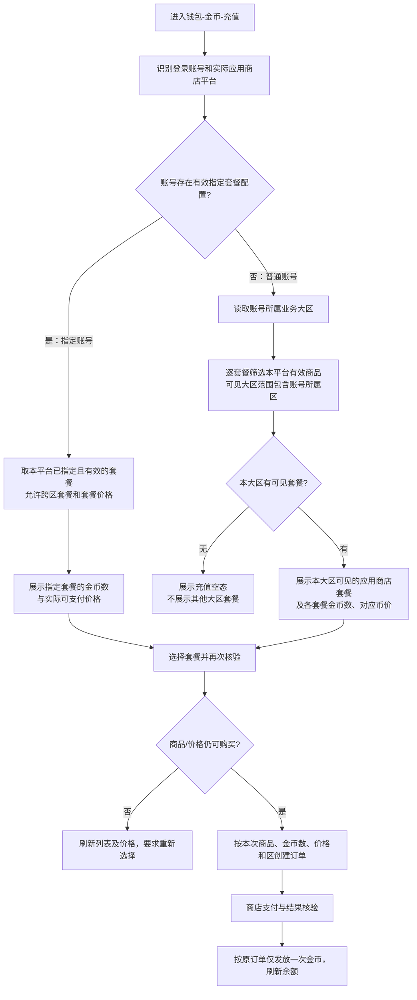

# 充值套餐分区需求文档

> 版本：用户分区优化需求 1.0 · 充值套餐专项  
> 范围：App 内「钱包 → 金币 → 充值」的 iOS／安卓应用商店套餐展示、审核账号例外及从选档到到账的价格一致性。不扩写第三方充值链接、币商售币、充值活动、钻石兑换金币的独立业务规则。

## 1. 需求目标

应用商店审核账号须能看到本平台提交且可实际展示的套餐；普通账号按所属大区查看适用套餐及币价。

**已确认业务原则：每个应用商店套餐都支持单独配置其可见大区范围，一个套餐可配置多个大区。**普通账号仅看到“本端商品＋该套餐可见范围包含本人所属大区＋当前生效”的套餐及对应币价；审核账号走账户指定的跨区套餐例外。例外仅覆盖套餐可见范围和对应币价，**不等于**绕过平台、商品生效、真实支付、到账或订单校验。

## 2. 业务对象与适用边界

| 对象／维度 | 业务定义 | 不应混用 |
|---|---|---|
| 用户业务大区 | 登录账号当前可信归属的大区，是普通账号查询可见套餐的维度。 | 不用客户端语言、IP 国家或应用商店国家代替。当前已核实业务区为 EN、MENA、TR；实际可配置范围以本版本正式启用区为准。 |
| 应用商店平台 | 用户实际运行的 iOS 或安卓端所对应的商店商品集合。 | iOS 套餐不可因为账号例外跑到安卓列表；安卓反之亦然。 |
| 商店套餐 | 可辨认的具体商店商品；**每个套餐独立维护可见大区范围**，同时关联对应平台、金币数、价格／币种来源和生效状态。 | 可见大区是套餐本身的配置，不能只在页面上设一个全局大区过滤条件；“套餐可见”不代表已下单或获得金币。 |
| 普通账号 | 未命中有效的指定账号套餐配置的账号。 | 默认按本人所属大区和平台展示，不按运营后台当前选择的大区展示。 |
| 审核账号／指定账号 | 被配置为可查看指定商店套餐的账号，用于应用商店审核展示；此配置可包含其他业务区定价的套餐。 | 不是整个客户端解除分区；也不自动改变用户真实大区。 |
| 展示币价与支付价 | 套餐列表／按钮给用户看的价格，与用户实际确认、商店扣款的价格对应。 | 不能先显示跨区套餐价，下单时再按账号所属区重算成另一价格。 |

### 2.1 版本范围

- 本期针对**应用商店内购金币套餐**，覆盖 iOS 与安卓各自的商品集合；两端商品、币种及价位不假定一一相同。
- 现有金币余额展示及到账后的余额刷新继续沿用既有产品能力；本期新增的是套餐的分区可见、账号例外与价格口径一致。
- 钻石兑换金币及其按大区确定的兑换比例属于另一模块，不纳入本专项充值套餐规则。
- 第三方充值链接、H5 自定义充值、充值活动、支付国家／汇率等不由本专项定义；不得把本专项的审核账号例外顺手赋给这些渠道。

## 3. 套餐展示与定价规则

### 3.1 两条互斥路径及优先级

| 判断顺序 | 账号情况 | 可见套餐 | 价格来源 |
|---|---|---|---|
| ① 固定平台 | iOS 仅查看有效 iOS 商店商品；安卓仅查看有效安卓商店商品。 | 无对应平台商品时为空。 | 按该平台商店商品提供的实际可支付价格展示。 |
| ② 指定账号优先 | 当前账号命中有效的“指定账号可见套餐”配置。 | 展示**该账号被指定**、属于当前平台且在有效状态的商店套餐；允许跨大区展示。 | 使用所选指定套餐对应的生效价格，**不再按账号所属大区重新套价**。 |
| ③ 普通路径 | 未命中有效的账号指定配置。 | 对**每个套餐逐一判断**：当前平台匹配、套餐生效、其可见大区范围**包含账号所属大区**才展示；不命中的套餐不展示。 | 使用命中本区的套餐对应生效币价；支付前仍须与商店实际可支付价格一致。 |

- “指定账号”是**整套套餐可见规则的优先路径**，不与普通区域套餐取并集。
- 审核账号的配置清单须覆盖该平台为了本次审核**已提交且可实际展示的全部商店套餐**。这是用户确认的审核目的，不应只随意指定两三个档位导致审核无法看到其他已提交档位。
- 指定账号正式可购买列表仅取已生效且可购买的套餐；已提交但尚未生效的商品不得展示为可购买。
- 每个套餐可独立配置一个或多个可见大区，其他套餐的配置不随之改变。普通账号仅在本人所属区命中**该套餐自己的可见范围**时看到它；指定账号不受此范围和本人所在区价格限制，但仍受平台、有效性与本账号指定清单限制。
- 账号属性或所在大区发生变化、商店商品停用、指定配置撤销后，**下一次列表查询**按最新有效配置重新计算；已经创建的有效交易不因列表变化被改写价格或金币数。

### 3.2 每个套餐可见大区范围的判定与变更

1. **配置粒度是单个商店套餐**：套餐甲可同时在 EN、TR 可见，套餐乙仅在 MENA 可见；不能仅用一个全局大区开关替代逐套餐可见范围。每档即使金币数或价位相近，也分别读取自己配置的可见范围。
2. **普通账号逐套餐判定**：账号所属区命中套餐的可见大区范围，该套餐才有资格进入本端列表；未命中即不展示，也不能通过缓存列表、改前端区域值、旧页面下单购买。区域匹配之外仍须同时满足平台和生效状态。
3. **一包多区**：同一套餐可选多个可见大区；新增某大区后，仅新增该区普通账号的可见资格；从范围中移除某大区后，该区普通账号的新列表与新下单不再包含此套餐，其他已配置大区不受影响。已创建订单不因配置变更重算。
4. **审核账号优先**：指定账号已命中有效指定清单时，按清单与平台、生效状态取商品；即便其所属区未包含在某个指定套餐的可见范围内，仍可按该跨区套餐的价格展示与购买。不要为让审核账号看到商品而把该套餐的可见范围改成全区，否则会误向普通账号开放。
5. **无命中兜底**：某套餐的可见范围不含普通账号所属区时，该账号看不到它；若该平台没有任何命中套餐，显示充值空态，不自动改取其他区或全区商品。历史套餐未配置可见范围时，不自动视为全区可见。

| 套餐配置示意（非真实商品／价格） | 可见大区范围 | EN 普通账号 | MENA 普通账号 | TR 普通账号 | 指定审核账号（清单含此套餐） |
|---|---|---|---|---|---|
| 套餐甲 | EN、TR | 可见 | 不可见 | 可见 | 本端且生效时可见 |
| 套餐乙 | MENA | 不可见 | 可见 | 不可见 | 本端且生效时可见 |

### 3.3 展示价、成交价与到账金币一致

1. 列表里的每个套餐须对应明确的金币数量、商店商品以及价格与币种；底部「立即充值」显示**当前选中套餐**的价格。
2. 点击购买前，以当前登录身份、当前平台和可见路径再次判断套餐是否仍有效且仍可购买：普通账号重查**所选套餐的可见范围是否仍包含本人所属区**，指定账号重查该商品是否仍在本人有效指定清单内；页面中的旧价格或旧权限不能直接成为成交依据。
3. 购买形成订单时，固定本次选中的商品、金币数、实际购买价格及币种、用户身份与下单时业务大区。支付成功后的发币量按该笔订单对应套餐确定，不因之后切区、配置改价或撤销审核身份而重新计算。
4. 应用商店最终收银台金额须与提交给用户的同一商品价格口径一致；若列表价与实际商店价不一致，不能一边显示旧价一边继续让用户确认购买，须刷新／重新确认该商品信息。
5. 重复支付通知、客户端重复验单或重试须按同一笔商店交易做**发币幂等**：不能重复发金币；退款与撤销按原订单身份、原发币量和原业务区处理，不按现区价格重算。具体退款资产冲正口径沿用现有充值规则，本专项不擅定负余额、追回顺序等新规则。

## 4. 客户端：钱包「金币 → 充值」

### 4.1 页面定位与对应原型

「钱包」金币页签展示余额、充值档位与底部购买入口，对应原型如下。

完整画布：[钱包页 Axure 画布](./原型图/钱包_充值套餐分区_Axure画布.png)。截图仅清楚露出四档，不据此确定套餐总数或全部配置价格。

### 4.2 页面字段定义

| 位置 | 可见元素／原型示例 | 页面定义 |
|---|---|---|
| 顶部页签 | 金币、钻石、水晶、游戏币；当前为金币 | 沿用钱包页签，本文仅约束金币充值区块。 |
| 金币余额 | 「我的金币余额」，截图显示 `192183360` | 读取当前登录账号余额；该数只是截图数据。 |
| 套餐列表 | 图中可读 `9000／$0.99`、`27000／$2.99`、`45000／$4.99`、`90000／$9.99` | 每行展示对应套餐的金币数及其可支付价格；图中数值是界面示例，不是本期固定档位或全区统一价。 `$` 仅为截图符号，不能据此规定所有区域／商店币种。 |
| 当前选中档位 | 页面中某档被选中 | 底部价格随选中套餐切换；默认选档沿用既有交互。 |
| 充值按钮 | 「立即充值（$0.99）」 | 价格与当前选中套餐一致；支付中阻止重复发起同一次购买。 |
| 页面底部 | 服务条款、隐私政策 | 沿用现有展示，不因审核账号例外改变。 |

### 4.3 交互逻辑

1. 进入本页：在当前端和登录账号条件下获取可见套餐；显示加载中，拿到可购买套餐后呈现列表、可选状态与价格。
2. 普通账号：列表对**每个套餐**分别按其可见大区范围筛选，只展示范围包含本人所属区的本端有效套餐；不同套餐可配置不同区或多区。不提供用户自行切大区购买另一套档位的入口。
3. 指定审核账号：不改变页面布局，不显露后台设置；列表替换为本端指定且有效的全量审核套餐。**可见跨区套餐不改变钱包余额所属账号或用户业务区**。
4. 选择某档：更新选中态、底部按钮显示价格；点击「立即充值」后走该商店商品的原购买流程。交易结果由商店支付及订单核验决定，不以按钮点击视为到账。
5. 购买成功：刷新金币余额与可见档位；支付取消或失败时不增加余额。用户离开再进入页面时，重新根据账号权限、所在区、平台与配置获取套餐。

### 4.4 页面状态与异常

| 场景 | 页面表现与业务动作 |
|---|---|
| 无本端可见且有效套餐 | 展示套餐空态，不展示可误点的价格或可购买状态；不擅自降级显示其他大区商品。 |
| 审核账号指定清单为空、无本端商品或商品全部失效 | 页面不回退到“跨区任意商品”；按实际有效可见集合展示，空集合时不可购买。配置完整性需后台处理。 |
| 加载或网络失败 | 保留钱包页面，提示加载失败及重试；旧列表不可作为新的成交依据。 |
| 套餐刚被停用、**本套餐可见范围移除了用户所属区**，或账号指定配置刚被修改 | 提交购买前发现不再可买时停止下单，刷新列表、选中态与按钮价格；不得换成另一区同价商品继续买。 |
| 商店返回价格与列表不一致 | 按真实可支付商品重新展示并要求用户确认，不能静默按旧展示价继续。 |
| 支付取消／失败／待核验 | 不显示已到账；状态待核验时避免重复生成同一笔发币结果，最终以订单核验为准。 |
| 支付成功后账号切区或被撤销审核资格 | 按购买时订单快照完成原单到账和对账；新开列表使用当前身份与归属的新规则。 |

## 5. 套餐配置与审核账号配置

### 5.1 商店套餐配置

| 配置内容 | 业务规则 |
|---|---|
| 平台及商店商品 | 明确商品归属 iOS 或安卓、可辨认的商品身份；同一商品不因账号所属区被解释成另一件商品。 |
| 金币数量与适用价格 | 明确每个可销售套餐发放金币数及展示／下单价格口径；跨区价格不同的套餐要能独立辨识，不能仅靠相同的图片或金币数量区分。 |
| **每个套餐的可见大区范围（核心配置）** | **逐套餐独立配置、允许多选大区**；普通账号所属区包含在该套餐范围内才可见。一个套餐增加／移除大区只影响该套餐对相应大区的**新列表与新订单**，不连带更改其他套餐、已创建订单或指定审核账号清单。未配置历史套餐不得自动视作全区可见。 |
| 生效状态 | 普通账号和指定账号的正式可购买列表都只取有效商品；配置变更后的页面展示与既有订单分开处理。 |
| 发布与追溯 | 配置启停、**单套餐可见大区范围**、商品定价及金币数量变更应有生效时点和历史版本，供订单、客服与财务核对；已创建订单按原成交信息保留，不追溯改价。 |

### 5.2 审核账号指定套餐配置

- 配置对象为**指定用户账号**，套餐列表按商店平台分别维护；至少能判断账号是否存在有效指定配置、指定了哪些商店商品、配置何时生效及撤销。这里的“审核账号”是使用场景，不据此赋予运营后台其他管理权限。
- 为满足审核目的，指定套餐清单须与本平台本次提交审核、可以实际展示的商店商品清单逐项核对，避免漏档。**指定列表只作用于该账号**，不改变普通账号可见区范围，也不改变区域定价配置。
- 配置账号指定商品时，不以该账号所属大区是否命中**每个套餐自己的可见范围**作为限制；允许选择其他区定价的套餐。审核账号在本端看到的是商品本身对应的价位和金币数，购买成功亦按该商品原订单落账。普通套餐范围本身不因审核配置被扩至全区。
- 配置撤销、修改或商品停用后，新列表及新订单按新的有效集合执行；历史订单、已支付交易及已到账金币不倒算。
- 后台操作至少可追溯操作者、指定账号、平台、套餐集合、修改前后内容与生效时间。

## 6. 订单与资产闭环

| 阶段 | 普通账号 | 指定审核账号 | 共通约束 |
|---|---|---|---|
| 查询套餐 | **逐套餐**判断本人所属区是否在该套餐可见范围内，叠加本端与生效条件 | 账号指定＋本端＋有效，允许跨区，不要求套餐范围包含本人所属区 | 服务端以真实登录账号及平台条件确认，不接受前端自行声明“我是审核账号”。 |
| 选档和展示 | 显示所选区域适用商品的金币数与价格 | 显示指定商品的金币数与价格 | 金币数量、币种和价格前后一致。 |
| 创建交易 | 重查**所选套餐自己的可见范围**仍包含本人所属区 | 核验账号仍有该商品指定资格；不套用普通账号的套餐范围限制 | 固定商品、金额、币种、金币数、购买账号和下单时业务区。 |
| 商店支付 | 按所选商品实际结算 | 同样按所选跨区商品实际结算 | 不用用户当前区重新换商品或改价；支付取消／失败不发币。 |
| 到账及重试 | 原订单到账本人账户 | 原订单到账该审核账号本人账户 | 同笔支付只发一次；延迟通知按原单恢复，不重新执行列表选档。 |
| 退款／对账 | 回看原单价格、金币数及发生区 | 同左；标识当时的指定账号例外来源 | 不因用户之后切区或权限撤销重写历史。 |

审核账号跨区套餐仅影响**售卖资格与选档价格**，不改变账号资产所属区。用户真实归属、订单发生时区和所购商品的价格来源须分别保留，不得互相覆盖。

## 7. 场景矩阵与冲突反例

| 场景 | 预期口径 |
|---|---|
| 两个普通账号分属不同大区，在同一平台打开金币充值 | 对同一批套餐分别计算各自所属区是否命中**每个套餐独立的可见范围**；套餐甲配置 EN＋TR、套餐乙仅 MENA 时，EN／TR 只见甲，MENA 只见乙。 |
| 只修改套餐甲的可见大区范围，不修改套餐乙 | 只改变甲在新增／移除大区普通账号的新列表与新购买资格；乙保持原有范围，甲与乙历史订单均不追溯。 |
| 套餐原本对普通账号不可见，但被指定给审核账号 | 审核账号在对应平台仍可看该已指定且生效套餐；不能为了审核放宽套餐的普通可见大区范围。 |
| 同账号在 iOS 与安卓端分别打开 | 各自只看对应平台商品；审核账号指定了另一端商品也不混入本端。 |
| 审核账号仍属 A 区，被指定了 B 区价位商品 | 显示指定的跨区商品及其实际可支付价格；选中后底部按钮、支付、到账金币数与该商品一致，不回套 A 区价。 |
| 审核账号指定清单只含本次提交套餐的一部分 | 不满足“审核可见全部已提交套餐”的目标；发布前对齐清单，不能当成功配置放过。 |
| 普通账号列表加载后被切区／商品停用 | 原列表作废；新购买必须按最新身份和有效商品重新确认。 |
| 审核账号下单后，指定配置被撤销或用户切区 | 新购买按新权限处理；原单的支付回调、到账和退款继续沿原订单快照。 |
| 商店价格与页面价格不一致 | 不静默购买；刷新或要求重新确认真实价格，避免错价成交。 |
| 商店支付消息重复、用户重试验单 | 一笔支付只对应一次金币到账；重复消息只返回原处理结果。 |
| 已提交但未生效的审核商品 | 不展示为可购买；生效后的可购买列表仍按本平台有效指定清单展示。 |

