# 充值套餐分区需求文档

> 版本：用户分区优化需求 1.0 · 1.0 MVP。本文只写本次分区调整，未变更功能沿用现状。

## 1. 产品概述与目标

为避免土区更换币价影响中东区用户，增加按业务大区控制 APP 登录与全量踢下线的能力。其余分区调整：根据用户所属业务大区，分别配置充值套餐与币价、兑换比例（含金币兑游戏币）、游戏档位、CP 档位与奖励、VIP 等级与权益、送礼财富值、收礼魅力值及财富与魅力等级；后台 VIP 发放按 VIP 所属大区操作。

## 2. 系统角色定义

- **普通账号**：按本人所属大区使用相应配置。
- **指定账号**：在应用商店充值场景展示为该账号指定的本端套餐。
- **BD／公会**：在各自可提现余额入口兑换金币。
- **后台操作人**：维护应用商店套餐、指定账号及 VIP 发放；区域数据查询与操作以所选大区为范围。
- **服务端**：按配置判定用户所属大区是否允许登录 APP，并支持对指定大区在线用户全量踢下线。

## 3. 核心规则

### 3.1 区域与配置

业务大区从可信用户资料读取。应用商店套餐、三方充值、钻石兑换、金币兑换游戏币、可提现余额兑换、百顺游戏、CP、VIP、送礼财富值、收礼魅力值及财富与魅力等级**分别按大区配置**，各模块使用自己的配置，不共用套餐或兑换比例。历史用户 `region=null` 沿现有规则归 EN；本期用户不能自行切区。

### 3.2 应用商店套餐判定

| 账号类型 | 套餐展示与购买资格 |
| --- | --- |
| 普通账号 | 仅显示当前 iOS／安卓端**每个套餐自己配置的可见大区范围**包含本人所属区、且正在生效的套餐及其币价；同一套餐可配置多个大区。 |
| 指定账号 | 优先显示为该账号指定的**本端、正在生效**的套餐及对应币价，可展示其他大区套餐；不叠加普通账号列表，也不修改该账号所属大区。 |

套餐区域范围或指定清单变化后，新列表及新下单按当前配置判断；已生成的订单仍按原商品、价格、金币数量与购买时归属处理。购买前重查所选套餐资格，商店价格变化则重新确认；同一笔商店交易只发一次金币。

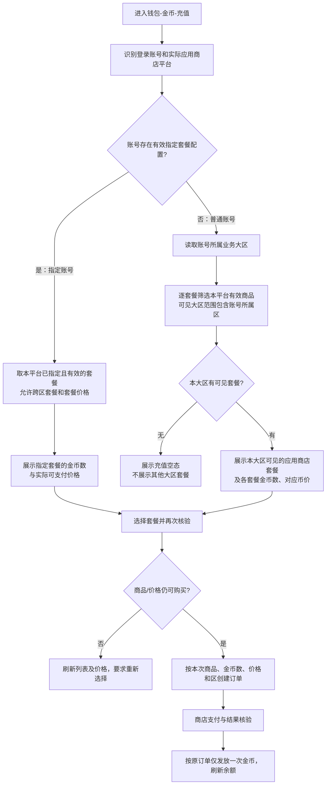

### 3.3 APP 登录限制与指定大区全量踢下线

#### 适用范围与判定口径

| 场景 | 判定依据 | 业务结果 |
| --- | --- | --- |
| APP 登录 | 登录账号所属业务大区，以及该大区当前的允许／不允许登录配置 | 允许：继续原登录流程；不允许：阻止本次登录，客户端 Toast“抱歉系统维护中，暂时无法登录”。 |
| 指定大区全量踢下线 | 在线账号所属业务大区与本次指定大区是否一致 | 目标大区全部当前在线账号结束 APP 登录状态并强制退出；其他大区在线用户不受影响。 |
| 被踢下线后重新登录 | 再次登录时账号所属业务大区的当前登录配置 | 重新执行登录判定；踢下线本身不代替后续登录限制。 |

- 业务大区读取口径沿用第 3.1 节；不以 IP、语言或商店地区代替账号业务大区。登录限制与全量踢下线是两项独立能力：只调整登录配置不会自动替代对已在线用户的踢下线操作；只踢下线也不会自动将该大区设置为“不允许登录”。
- 可单独限制土区，不能将土区限制应用到中东区用户。登录限制不修改原有充值套餐可见范围、币价或其他大区配置。

#### 业务流程图

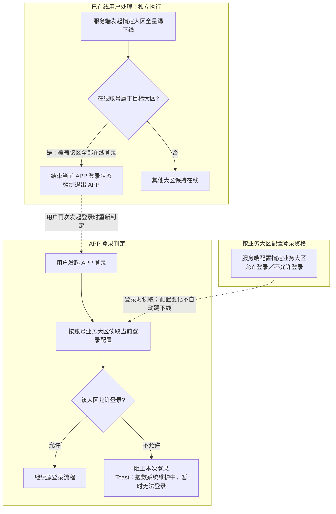

## 4. 客户端功能模块

### 4.1 钱包金币充值：应用商店套餐

#### 对应原型

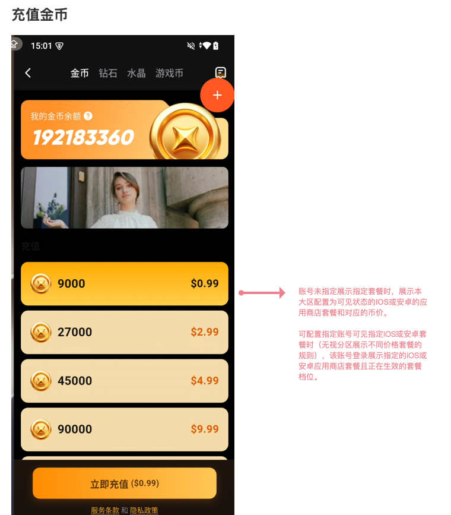

[钱包完整画布](./原型图/1.0MVP_钱包_画布.png)

#### 功能点：本区套餐与指定账号套餐

##### 功能说明

- **普通账号**：按当前端和本人所属大区，逐套餐展示本区可见且正在生效的商店套餐、金币数和币价。
- **指定账号**：展示后台为该账号指定的当前端生效套餐及对应币价；指定套餐可跨大区展示。指定清单优先于普通账号区域列表。

##### 字段与数据来源

| 字段 | 说明 | 统计方式 | 数据来源 |
| --- | --- | --- | --- |
| 套餐可见大区范围 | 每个商店套餐独立配置，可多选 | 新列表／新订单按当前生效配置 | 套餐配置 |
| 指定账号套餐清单 | 按账号及 iOS／安卓端指定 | 新列表／新订单按当前生效配置 | 指定账号配置 |

##### 交互逻辑

进入金币充值页加载适用套餐；切换档位同步切换金币数与按钮价。点击购买时再次校验当前账号、平台和所选套餐的可购资格；无本端可购套餐时显示空态。支付核验和到账按第 3.2 节处理。

### 4.2 三方充值链接

#### 对应原型

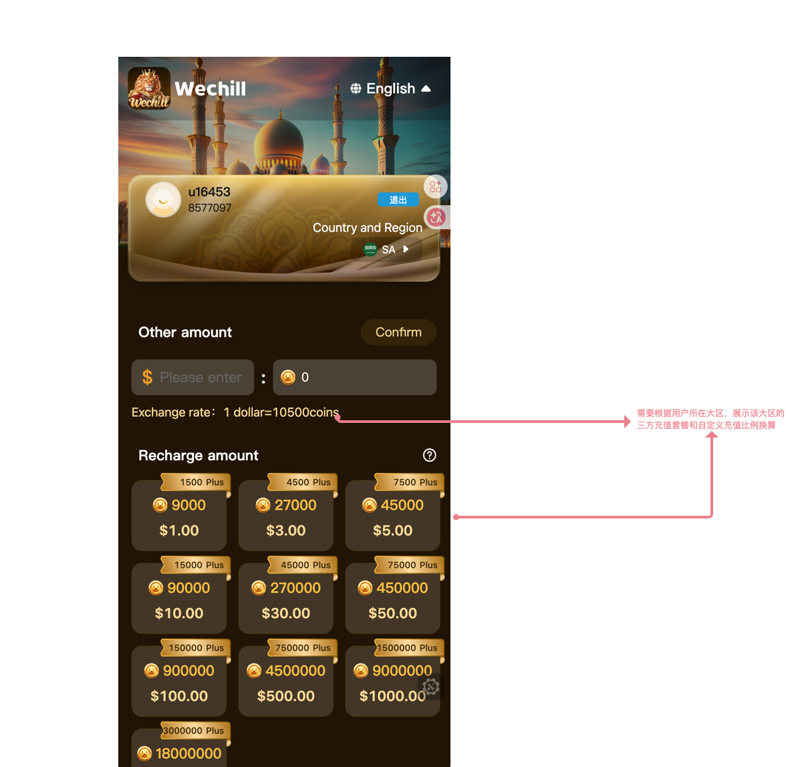

#### 功能点：本区套餐与自定义充值

##### 功能说明

- 固定充值套餐：按购买用户所属大区展示该区三方充值套餐及币价。
- 自定义充值：输入金额后，按**该区自定义充值比例**换算预计金币；金额变更时同步更新。

##### 字段与数据来源

| 字段 | 说明 | 统计方式 | 数据来源 |
| --- | --- | --- | --- |
| 三方充值套餐及币价 | 所属大区对应套餐 | 本次查询 | 本区三方充值配置 |
| 自定义充值比例 | 金额换算金币的本区比例 | 本次输入金额时 | 本区自定义充值配置 |

##### 交互逻辑

进入链接读取购买账号所属区并展示该区套餐；选套餐或填写自定义金额后，以该区对应配置形成交易。应用商店指定账号套餐不影响此处展示。

### 4.3 钱包钻石兑换金币

#### 对应原型

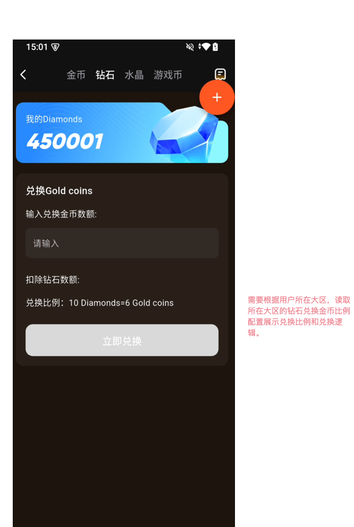

#### 功能点：本区钻石兑换比例

##### 功能说明

钱包钻石兑换金币使用**用户所属大区的钻石兑金币比例**。输入目标金币数量时，页面按该比例展示所需钻石；提交兑换时按本区比例完成扣钻与加金币。

##### 字段与数据来源

| 字段 | 说明 | 统计方式 | 数据来源 |
| --- | --- | --- | --- |
| 钻石兑金币比例 | 本区兑换配置 | 本次输入与提交 | 所属大区钻石兑换配置 |

##### 交互逻辑

输入金币数量后更新预计消耗钻石；提交前校验余额和本区比例。同笔兑换扣钻与加金币对应一次结果，重复提交不得重复扣钻或加金币。

### 4.4 钱包金币兑换游戏币

#### 对应原型

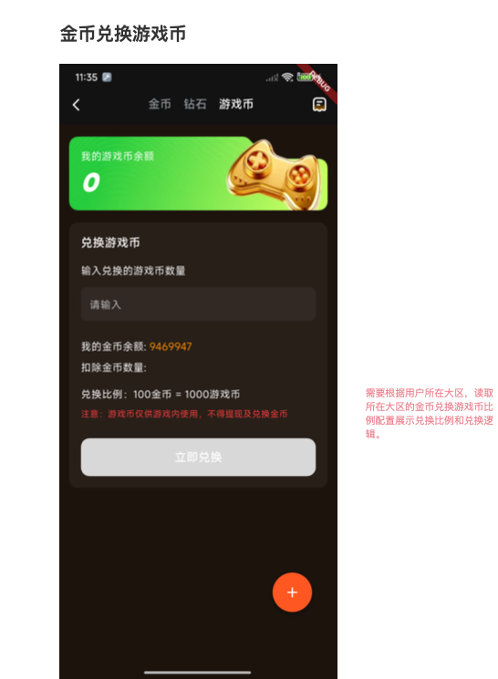

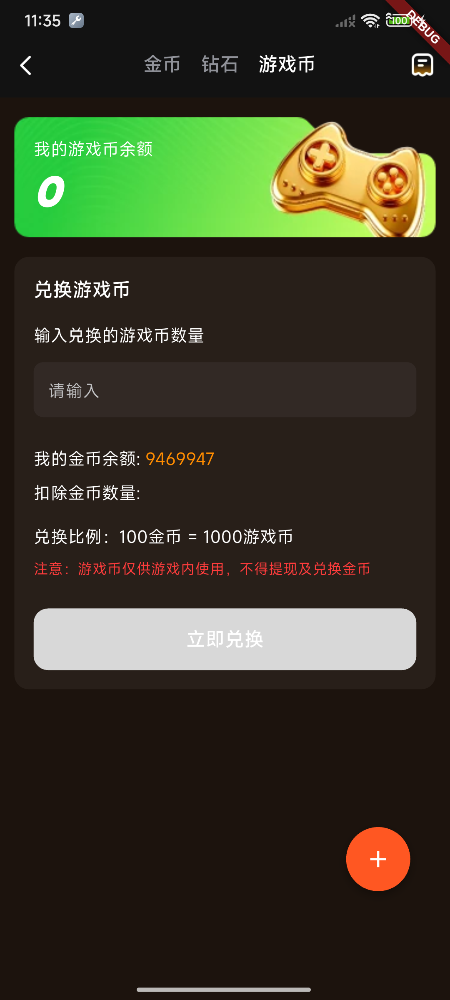

[钱包新增页面完整画布](./原型图/1.0MVP_钱包_新增游戏币全画布.png)

#### 功能点：本区金币兑换游戏币比例

##### 功能说明

进入钱包「游戏币」页的「兑换游戏币」区域，按**用户所属大区的金币兑游戏币比例配置**展示兑换比例。用户输入要兑换的游戏币数量时，按该区比例更新所需扣除的金币数量；兑换提交时使用同一区比例完成金币扣除与游戏币增加，不使用其他大区的比例。

##### 字段与数据来源

| 字段 | 说明 | 统计方式 | 数据来源 |
| --- | --- | --- | --- |
| 金币兑游戏币比例 | 用户所属大区的兑换配置 | 当前页面展示与本次兑换使用该区比例 | 所属大区金币兑游戏币配置 |

### 4.5 BD／公会可提现余额兑换金币

#### 对应原型

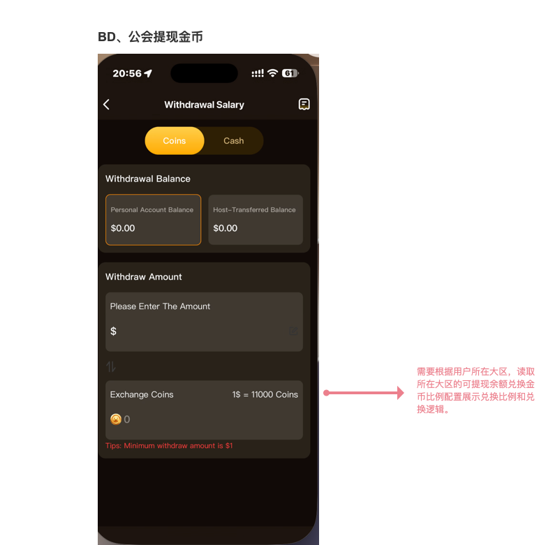

#### 功能点：本区可提现余额兑换比例

##### 功能说明

BD 和公会在各自可提现余额兑换金币入口，读取**所属大区的可提现余额兑金币比例**；输入兑换金额后，按该比例展示可兑换金币数量。

##### 字段与数据来源

| 字段 | 说明 | 统计方式 | 数据来源 |
| --- | --- | --- | --- |
| 可提现余额兑金币比例 | BD／公会对应业务区的兑换配置 | 本次输入与提交 | 所属大区可提现余额兑换配置 |

##### 交互逻辑

选择 Coins、输入金额，页面按本区比例更新金币数量；提交时使用该主体的可提现余额与本区比例完成兑换。BD 和公会各自按原余额归属处理，不合并为同一余额。

### 4.6 游戏分区

#### 对应原型

#### 功能点：百顺游戏列表与下注档位

##### 功能说明

首期**仅百顺**接入游戏分区，灵仙游和 zeeone 暂不接入。游戏列表按用户所属大区展示；**同一厂商的同一游戏**在不同大区展示各自配置的下注档位。百顺每个大区对应不同 APPID。

#### 功能点：游戏记录与流水归区

##### 功能说明

游戏记录明细和流水记录**业务发生大区**，支持后续按区统计与分区结算；记录按该局发生区归属。

### 4.7 CP 分区

#### 功能点：组建 CP 的礼物与档位

组建 CP 的**礼物、礼物价格、组建奖励、组建档位**分别按大区配置。选择本区档位时，礼物、价格与奖励同步展示该区配置；组建时按所选档位处理扣费与奖励。

#### 功能点：CP 等级与奖励

**CP 等级档位、每级所需经验值、每级奖励内容**分别按大区配置。等级进度与奖励展示使用同一区配置；等级达成后按对应区发放该等级奖励。

[CP 完整画布](./原型图/1.0MVP_CP_画布.png)

### 4.8 VIP 分区

#### 对应原型

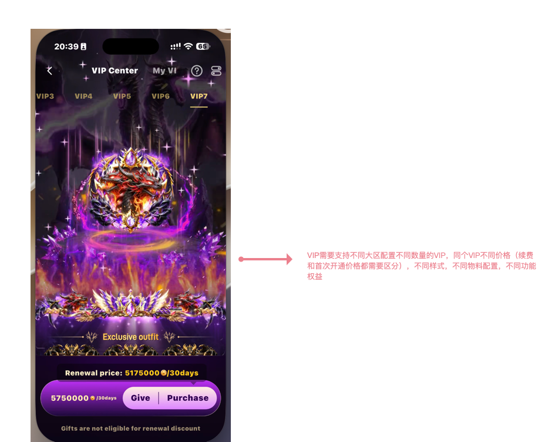

#### 功能点：本区 VIP 等级、价格与权益

##### 功能说明

不同大区可配置**不同数量的 VIP 等级**；相同 VIP 等级可按区配置不同的**首次开通价格、续费价格、样式、物料、功能权益**。VIP 页面按用户所属区展示该区等级，切换等级时同步展示该等级在本区的价格和权益；购买或续费按对应本区配置处理。

### 4.9 财富／魅力等级分区

#### 对应原型

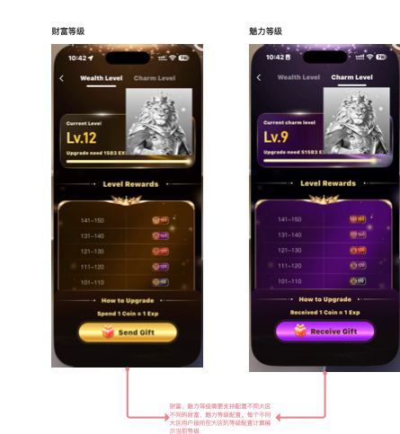

#### 功能点：本区财富与魅力等级

财富等级、魅力等级分别支持按大区配置等级规则。用户的财富等级和魅力等级分别依据**本人所属大区对应的等级配置**计算当前等级；财富、魅力两个 Tab 各自展示计算后的本区当前等级与升级进度。切换 Tab 时，展示对应类型的等级结果，不混用另一大区或另一类型的等级配置。

#### 功能点：送礼财富值与收礼魅力值分区

- 送礼用户获得的财富值，按**送礼用户所属大区**的财富值获取配置计算；收礼用户获得的魅力值，按**收礼用户所属大区**的魅力值获取配置计算。
- 获得的财富值、魅力值分别参与本人对应等级的计算；财富、魅力页的「How to Upgrade」说明分别按本人所属区的送礼、收礼获取配置展示。

### 4.10 APP 登录限制与强制退出

#### 模块背景

土区币价调整期间，需要单独控制土区用户登录，避免影响中东区用户；已在线账号还需承接服务端按区全量踢下线结果。

#### 用户场景

- 目标大区用户发起 APP 登录时，看到与该区当前登录配置一致的登录结果。
- 目标大区用户已在线，服务端执行该区全量踢下线后，用户退出当前 APP 登录状态。

#### 对应原型

本次未提供登录限制或强制退出的新页面原型；仅定义登录结果提示及退出行为，不新增页面、弹窗或操作入口。

#### 功能点：登录受限提示

##### 功能说明

用户发起登录时，按第 3.3 节的业务大区配置取得登录结果；不允许登录时停止本次登录并展示指定 Toast，允许时继续现有登录流程。

##### 前置条件

用户发起 APP 登录，服务端可依据账号业务大区进行登录资格判定。

##### 触发方式

用户按现有方式发起 APP 登录。

##### 字段与数据来源

| 字段 | 说明 | 统计方式 | 数据来源 |
| --- | --- | --- | --- |
| 登录结果 | 本次登录允许继续或被区域限制阻止 | 每次登录实时判定 | 服务端按账号业务大区读取的当前登录配置 |
| 登录受限提示 | Toast：“抱歉系统维护中，暂时无法登录” | 命中“不允许登录”时展示 | 本次固定提示文案 |

##### 交互逻辑

1. 发起登录后等待本次判定结果。
2. 允许登录：继续现有登录流程，不新增额外页面反馈。
3. 不允许登录：不进入登录成功态，展示 Toast“抱歉系统维护中，暂时无法登录”。

##### 服务端核心逻辑

登录时以账号业务大区为准，读取该大区当前登录配置并决定是否允许继续；不允许时阻断本次登录。区域归属沿用第 3.1 节，不受 IP、语言或商店地区影响。

##### 状态设计

| 状态 | 进入条件 | 客户端表现 |
| --- | --- | --- |
| 允许继续登录 | 账号所属大区当前允许登录 | 沿用现有登录流程。 |
| 登录受限 | 账号所属大区当前不允许登录 | 本次登录不成功，展示固定 Toast。 |

##### 边界条件

- 同一时刻不同大区用户分别读取各自大区的配置；目标大区受限不改变其他大区的登录资格。
- 用户曾被踢下线后再次登录，仍按再次登录时的当前配置判定，不沿用上一次踢下线结果。

##### 异常处理

仅区域限制命中时使用上述固定 Toast；其他登录异常沿用原登录流程，不冒用维护提示。

##### 权限控制

该限制按账号所属业务大区统一生效，不按普通账号／指定套餐账号区分；客户端不得自行绕过服务端判定。

##### 埋点

本次未定义新增埋点事件及参数。

#### 功能点：指定大区在线用户强制退出

##### 功能说明

服务端对指定大区执行全量踢下线时，该区全部当前在线用户结束 APP 登录状态并强制退出；其他大区在线用户保持原状态。

##### 前置条件

账号处于 APP 在线登录状态，且账号所属业务大区为本次踢下线目标大区。

##### 触发方式

服务端发起针对指定业务大区的全量踢下线。

##### 字段与数据来源

| 字段 | 说明 | 统计方式 | 数据来源 |
| --- | --- | --- | --- |
| 强制退出结果 | 当前 APP 登录状态结束 | 每次目标大区踢下线时判定 | 服务端按账号业务大区执行的踢下线结果 |

##### 交互逻辑

在线账号命中目标大区踢下线后，客户端退出当前 APP 登录状态；再次发起登录时重新走区域登录判定。未命中目标大区的在线用户不退出。

##### 服务端核心逻辑

以在线账号所属业务大区确定踢下线范围；目标大区的全部当前在线账号均结束当前 APP 登录状态，同账号的在线登录也纳入；不处理其他大区账号。踢下线不自动改写该区允许／不允许登录配置。

##### 状态设计

| 状态 | 进入条件 | 客户端表现 |
| --- | --- | --- |
| 在线 | 尚未命中本次目标大区踢下线 | 保持原登录状态。 |
| 被强制退出 | 当前在线账号属于本次目标大区并被踢下线 | 结束本次 APP 登录状态；重新登录需再次判定。 |

##### 边界条件

- 全量范围覆盖目标大区所有当前在线账号，不只覆盖新登录账号或单台设备。
- 允许登录与踢下线并不互斥：被踢用户重新登录时依当时配置判断；不因踢下线自动获得或永久失去登录资格。

##### 异常处理

未完成强制退出的在线账号不能视作已经踢下线；本次需求未定义失败重试方式或新的客户端失败提示。

##### 权限控制

仅服务端执行指定大区的全量踢下线；本次不新增客户端踢人入口。

##### 埋点

本次未定义新增埋点事件及参数。

## 5. 后台功能模块

### 5.1 VIP 发放

#### 对应原型

[VIP 发放完整画布](./原型图/1.0MVP_VIP发放_画布.png)

#### 功能点：VIP 赠送列表

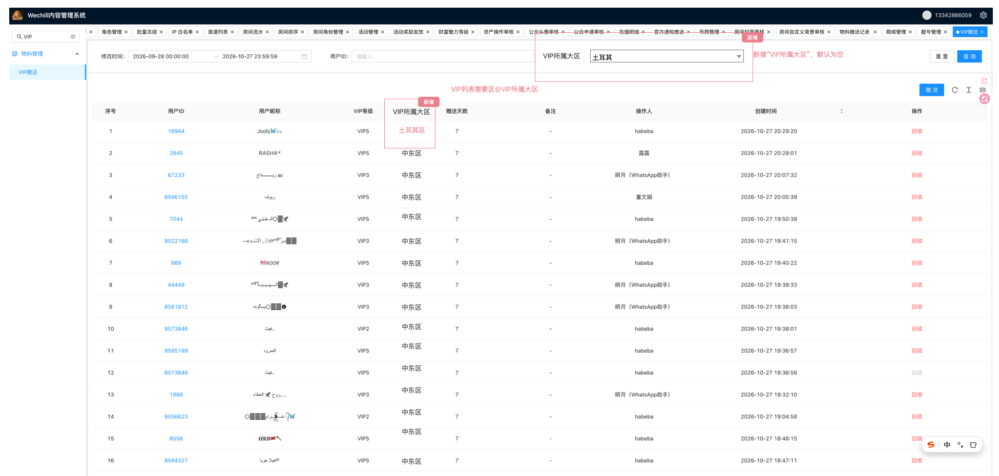

列表新增**VIP 所属大区**列和同名筛选项，筛选默认空；按所选大区查询、展示对应 VIP 赠送记录。

#### 功能点：申请赠送 VIP

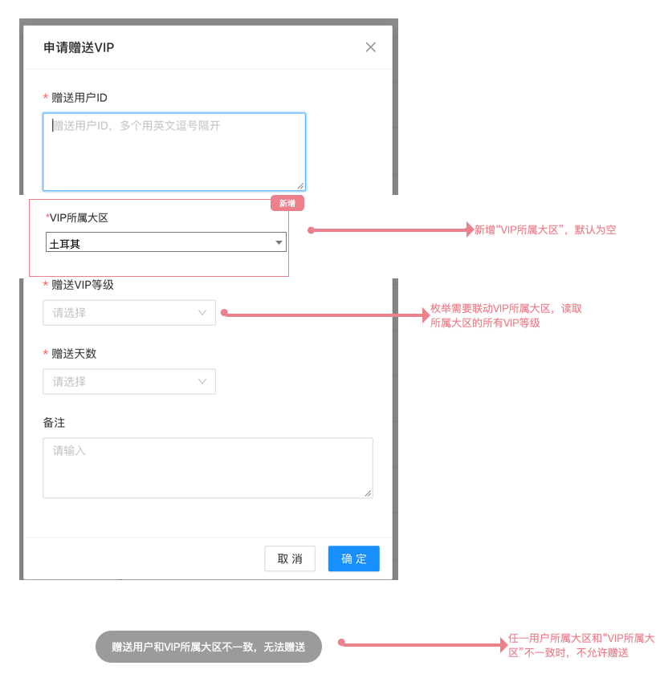

- 表单新增必填**VIP 所属大区**，默认空。
- 选定大区后，「赠送 VIP 等级」只列出**该大区的全部 VIP 等级**；重新选区时同步更新等级选项。
- 点击确定时，逐一校验所有赠送目标的所属大区；**任一目标与 VIP 所属大区不一致，则本次全部不赠送**，提示：`赠送用户和VIP所属大区不一致，无法赠送`。赠送执行使用提交时确定的目标用户 ID，不再通过号码重新定位。

### 5.2 指定大区登录配置与全量踢下线

#### 模块背景

为土区币价调整提供按业务大区隔离的登录控制，并能处理已在线用户，而不影响中东区等其他大区。

#### 用户场景

- 需要限制或恢复指定大区 APP 登录时，服务端按该区当前配置执行登录判定。
- 需要让指定大区全部在线用户退出时，服务端对该区执行全量踢下线。

#### 对应原型

本次未提供后台操作页面原型；本模块只定义服务端配置和执行能力，不新增后台页面字段或操作入口。

#### 功能点：按大区配置登录资格

##### 功能说明

服务端支持对指定业务大区配置“允许登录／不允许登录”，登录时仅按该账号所属区的当前配置判定。

##### 前置条件

已取得登录账号的业务大区；大区归属沿用第 3.1 节。

##### 触发方式

指定大区的登录资格配置发生变化，或用户发起 APP 登录。

##### 字段与数据来源

| 字段 | 说明 | 统计方式 | 数据来源 |
| --- | --- | --- | --- |
| 账号所属业务大区 | 登录资格的判定范围 | 每次登录按当前账号归属读取 | 可信用户资料，沿用第 3.1 节 |
| 大区登录资格 | 指定大区允许登录或不允许登录 | 每次登录按该区当前配置读取 | 服务端登录资格配置 |

##### 交互逻辑

本次未提供配置操作界面；用户发起登录后的客户端结果见第 4.10 节。

##### 服务端核心逻辑

按账号业务大区读取当前配置：允许则继续现有登录流程；不允许则阻断本次登录并使客户端展示固定 Toast。指定大区配置只影响该区账号，不连带改写中东区等其他大区配置；配置变化本身不代替在线用户踢下线。

##### 状态设计

| 配置状态 | 登录判定结果 | 对已在线用户的作用 |
| --- | --- | --- |
| 允许登录 | 继续现有登录流程 | 不因本次判定自动踢下线。 |
| 不允许登录 | 阻止本次登录 | 如需现有在线用户退出，另执行全量踢下线。 |

##### 边界条件

账号业务大区为空时沿用第 3.1 节既有区域归属规则；不按 IP、语言或商店地区判区。指定套餐账号仍按账号业务大区判断登录，不因跨区套餐可见例外绕过限制。

##### 异常处理

仅登录资格确认为“不允许”时展示固定维护提示；其他登录失败沿用现有异常处理，不推断为区域限制。

##### 权限控制

本次只定义服务端可配置能力，不定义后台页面或新增操作角色权限。

##### 埋点

本次未定义新增埋点事件及参数。

#### 功能点：指定大区全量踢下线

##### 功能说明

服务端支持按指定业务大区将该区全部当前在线用户强制退出 APP；其他区在线用户保持登录。

##### 前置条件

明确本次目标业务大区及当前在线账号的业务大区。

##### 触发方式

服务端发起针对指定大区的全量踢下线动作；本次不定义后台按钮或页面入口。

##### 字段与数据来源

| 字段 | 说明 | 统计方式 | 数据来源 |
| --- | --- | --- | --- |
| 目标业务大区 | 本次全量踢下线的唯一用户范围 | 本次动作按指定大区判断 | 服务端发起动作时指定的大区 |
| 在线账号所属业务大区 | 判断当前在线账号是否属于目标区 | 执行时按账号当前业务大区判断 | 可信用户资料，沿用第 3.1 节 |

##### 交互逻辑

服务端执行后，命中范围内的客户端结束当前 APP 登录状态；再次登录按第 3.3 节重新判断。其他区客户端不受本次动作影响。

##### 服务端核心逻辑

按在线账号的业务大区覆盖目标区全部在线登录，包括同账号的在线登录；使其当前 APP 登录状态结束并强制退出。该动作与大区登录资格配置独立，不自动修改配置。

##### 状态设计

| 在线状态 | 进入条件 | 结果 |
| --- | --- | --- |
| 目标区在线 | 在线账号业务大区为本次目标大区 | 当前 APP 登录状态结束，客户端强制退出。 |
| 非目标区在线 | 在线账号业务大区非本次目标大区 | 保持现有登录状态。 |

##### 边界条件

目标区的在线用户需要全量覆盖，不能仅拦截后续登录或只退出部分设备；重新登录与踢下线是两个独立判断环节。

##### 异常处理

执行失败的在线账号不能计入已踢下线范围；本次需求未定义失败补偿或重试策略。

##### 权限控制

本次仅定义服务端能力，后台发起人、操作入口与授权范围未在本次需求中定义。

##### 埋点

本次未定义新增埋点事件及参数。

