# 充值套餐分区需求文档

> 版本：用户分区优化需求 1.0 · 1.0 MVP。本文只写本次分区调整，未变更功能沿用现状。

## 1. 产品概述与目标

根据用户所属业务大区，分别配置充值套餐与币价、兑换比例（含金币兑游戏币）、游戏档位、CP 档位与奖励、VIP 等级与权益、送礼财富值、收礼魅力值及财富与魅力等级；后台 VIP 发放按 VIP 所属大区操作。本期覆盖「1.0 MVP」八页原型。

## 2. 系统角色定义

- **普通账号**：按本人所属大区使用相应配置。
- **指定账号**：在应用商店充值场景展示为该账号指定的本端套餐。
- **BD／公会**：在各自可提现余额入口兑换金币。
- **后台操作人**：维护应用商店套餐、指定账号及 VIP 发放；区域数据查询与操作以所选大区为范围。

## 3. 核心规则

### 3.1 区域与配置

业务大区从可信用户资料读取。应用商店套餐、三方充值、钻石兑换、金币兑换游戏币、可提现余额兑换、百顺游戏、CP、VIP、送礼财富值、收礼魅力值及财富与魅力等级**分别按大区配置**，各模块使用自己的配置，不共用套餐或兑换比例。历史用户 `region=null` 沿现有规则归 EN；本期用户不能自行切区。

### 3.2 应用商店套餐判定

| 账号类型 | 套餐展示与购买资格 |
| --- | --- |
| 普通账号 | 仅显示当前 iOS／安卓端**每个套餐自己配置的可见大区范围**包含本人所属区、且正在生效的套餐及其币价；同一套餐可配置多个大区。 |
| 指定账号 | 优先显示为该账号指定的**本端、正在生效**的套餐及对应币价，可展示其他大区套餐；不叠加普通账号列表，也不修改该账号所属大区。 |

套餐区域范围或指定清单变化后，新列表及新下单按当前配置判断；已生成的订单仍按原商品、价格、金币数量与购买时归属处理。购买前重查所选套餐资格，商店价格变化则重新确认；同一笔商店交易只发一次金币。

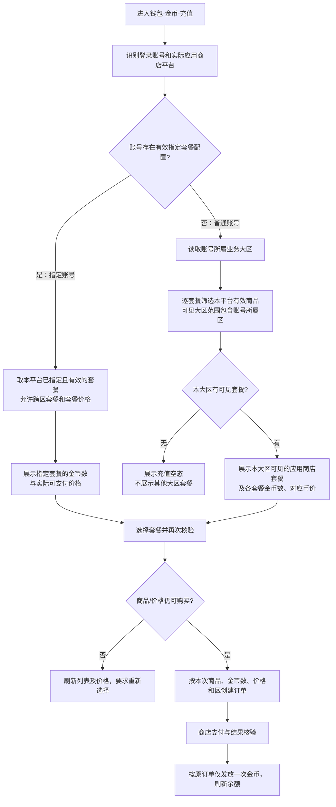

## 4. 客户端功能模块

### 4.1 钱包金币充值：应用商店套餐

#### 对应原型

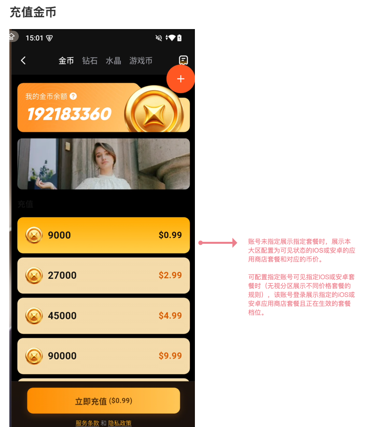

[钱包完整画布](./原型图/1.0MVP_钱包_画布.png)

#### 功能点：本区套餐与指定账号套餐

##### 功能说明

- **普通账号**：按当前端和本人所属大区，逐套餐展示本区可见且正在生效的商店套餐、金币数和币价。
- **指定账号**：展示后台为该账号指定的当前端生效套餐及对应币价；指定套餐可跨大区展示。指定清单优先于普通账号区域列表。

##### 字段与数据来源

| 字段 | 说明 | 统计方式 | 数据来源 |
| --- | --- | --- | --- |
| 套餐可见大区范围 | 每个商店套餐独立配置，可多选 | 新列表／新订单按当前生效配置 | 套餐配置 |
| 指定账号套餐清单 | 按账号及 iOS／安卓端指定 | 新列表／新订单按当前生效配置 | 指定账号配置 |

##### 交互逻辑

进入金币充值页加载适用套餐；切换档位同步切换金币数与按钮价。点击购买时再次校验当前账号、平台和所选套餐的可购资格；无本端可购套餐时显示空态。支付核验和到账按第 3.2 节处理。

### 4.2 三方充值链接

#### 对应原型

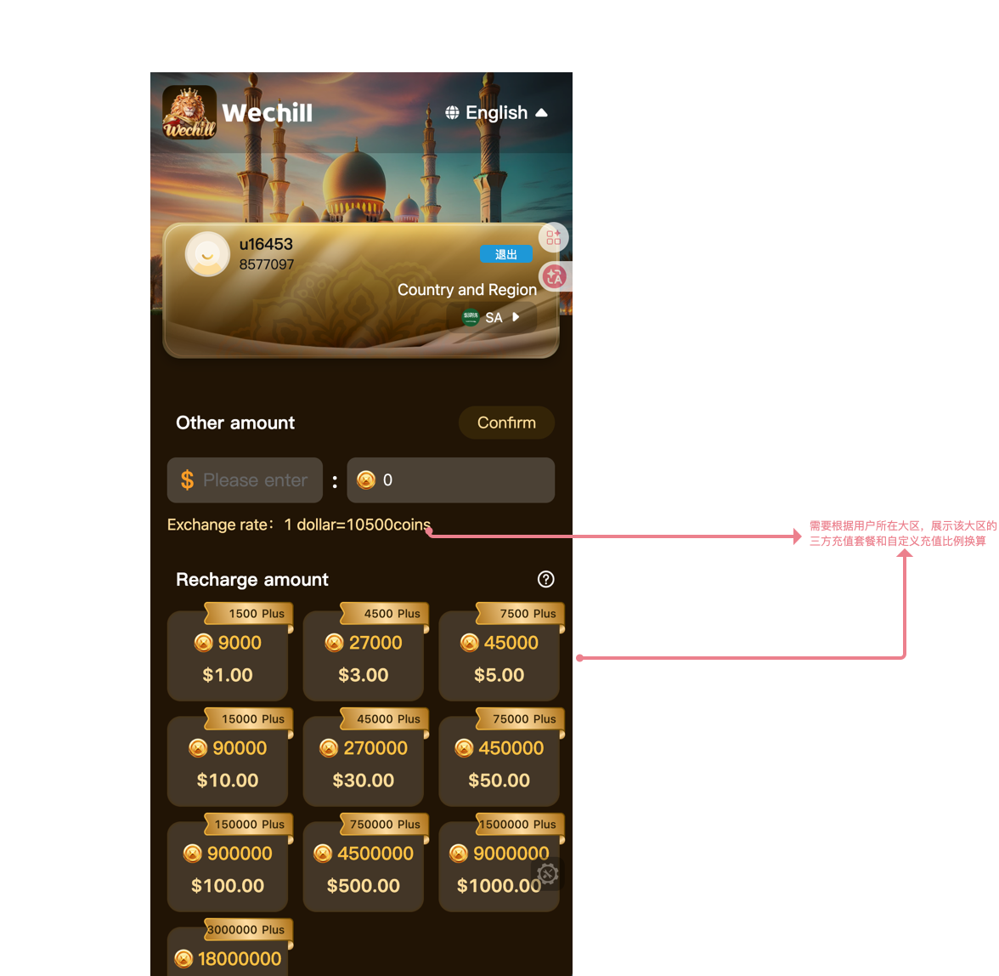

#### 功能点：本区套餐与自定义充值

##### 功能说明

- 固定充值套餐：按购买用户所属大区展示该区三方充值套餐及币价。
- 自定义充值：输入金额后，按**该区自定义充值比例**换算预计金币；金额变更时同步更新。

##### 字段与数据来源

| 字段 | 说明 | 统计方式 | 数据来源 |
| --- | --- | --- | --- |
| 三方充值套餐及币价 | 所属大区对应套餐 | 本次查询 | 本区三方充值配置 |
| 自定义充值比例 | 金额换算金币的本区比例 | 本次输入金额时 | 本区自定义充值配置 |

##### 交互逻辑

进入链接读取购买账号所属区并展示该区套餐；选套餐或填写自定义金额后，以该区对应配置形成交易。应用商店指定账号套餐不影响此处展示。

### 4.3 钱包钻石兑换金币

#### 对应原型

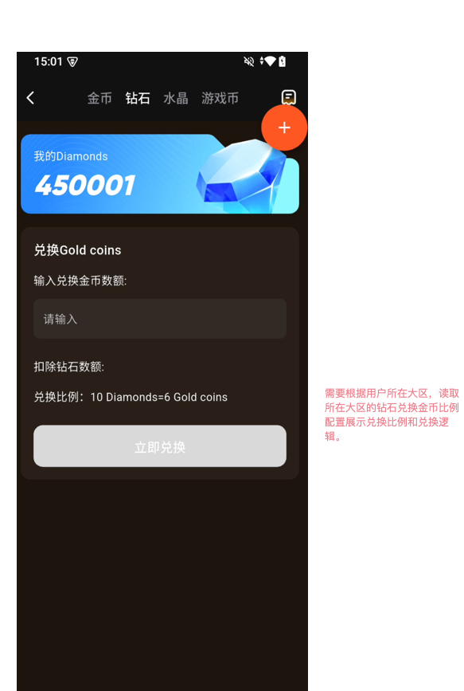

#### 功能点：本区钻石兑换比例

##### 功能说明

钱包钻石兑换金币使用**用户所属大区的钻石兑金币比例**。输入目标金币数量时，页面按该比例展示所需钻石；提交兑换时按本区比例完成扣钻与加金币。

##### 字段与数据来源

| 字段 | 说明 | 统计方式 | 数据来源 |
| --- | --- | --- | --- |
| 钻石兑金币比例 | 本区兑换配置 | 本次输入与提交 | 所属大区钻石兑换配置 |

##### 交互逻辑

输入金币数量后更新预计消耗钻石；提交前校验余额和本区比例。同笔兑换扣钻与加金币对应一次结果，重复提交不得重复扣钻或加金币。

### 4.4 钱包金币兑换游戏币

#### 对应原型

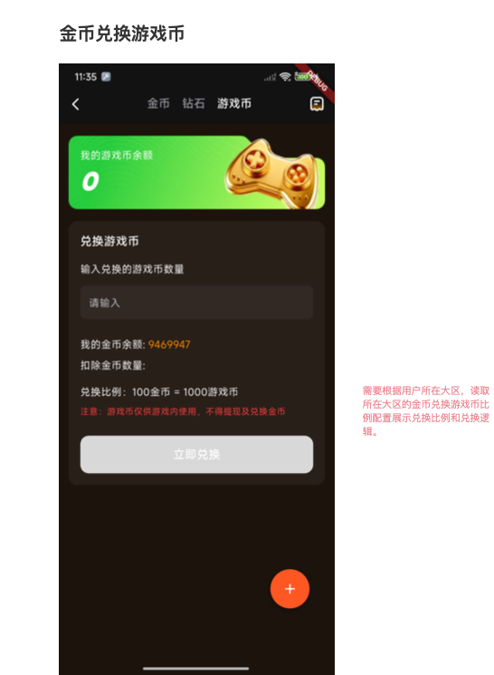

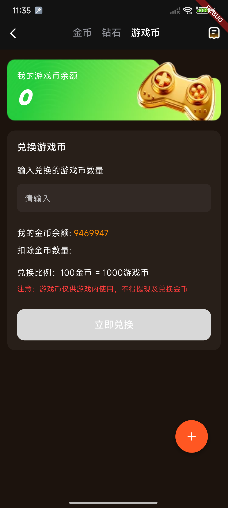

[钱包新增页面完整画布](./原型图/1.0MVP_钱包_新增游戏币全画布.png)

#### 功能点：本区金币兑换游戏币比例

##### 功能说明

进入钱包「游戏币」页的「兑换游戏币」区域，按**用户所属大区的金币兑游戏币比例配置**展示兑换比例。用户输入要兑换的游戏币数量时，按该区比例更新所需扣除的金币数量；兑换提交时使用同一区比例完成金币扣除与游戏币增加，不使用其他大区的比例。

##### 字段与数据来源

| 字段 | 说明 | 统计方式 | 数据来源 |
| --- | --- | --- | --- |
| 金币兑游戏币比例 | 用户所属大区的兑换配置 | 当前页面展示与本次兑换使用该区比例 | 所属大区金币兑游戏币配置 |

### 4.5 BD／公会可提现余额兑换金币

#### 对应原型

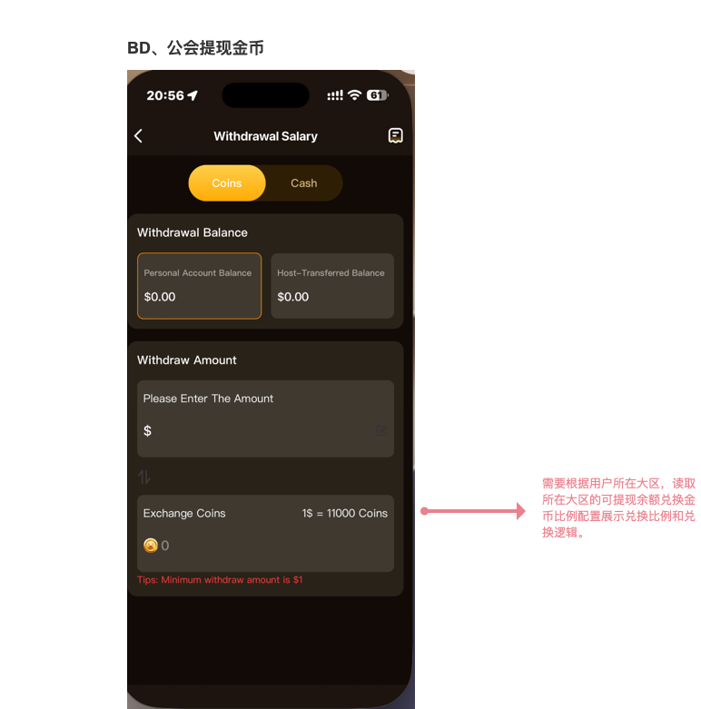

#### 功能点：本区可提现余额兑换比例

##### 功能说明

BD 和公会在各自可提现余额兑换金币入口，读取**所属大区的可提现余额兑金币比例**；输入兑换金额后，按该比例展示可兑换金币数量。

##### 字段与数据来源

| 字段 | 说明 | 统计方式 | 数据来源 |
| --- | --- | --- | --- |
| 可提现余额兑金币比例 | BD／公会对应业务区的兑换配置 | 本次输入与提交 | 所属大区可提现余额兑换配置 |

##### 交互逻辑

选择 Coins、输入金额，页面按本区比例更新金币数量；提交时使用该主体的可提现余额与本区比例完成兑换。BD 和公会各自按原余额归属处理，不合并为同一余额。

### 4.6 游戏分区

#### 对应原型

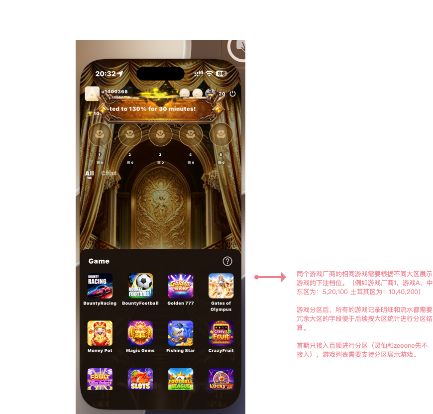

#### 功能点：百顺游戏列表与下注档位

##### 功能说明

首期**仅百顺**接入游戏分区，灵仙游和 zeeone 暂不接入。游戏列表按用户所属大区展示；**同一厂商的同一游戏**在不同大区展示各自配置的下注档位。百顺每个大区对应不同 APPID。

#### 功能点：游戏记录与流水归区

##### 功能说明

游戏记录明细和流水记录**业务发生大区**，支持后续按区统计与分区结算；记录按该局发生区归属。

### 4.7 CP 分区

#### 功能点：组建 CP 的礼物与档位

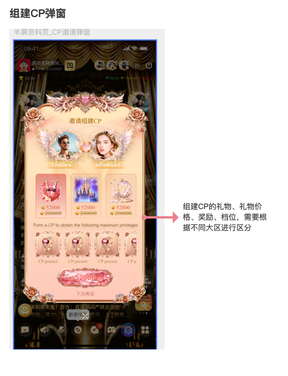

组建 CP 的**礼物、礼物价格、组建奖励、组建档位**分别按大区配置。选择本区档位时，礼物、价格与奖励同步展示该区配置；组建时按所选档位处理扣费与奖励。

#### 功能点：CP 等级与奖励

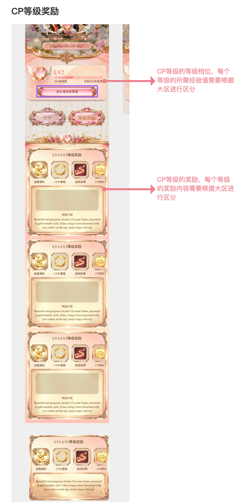

**CP 等级档位、每级所需经验值、每级奖励内容**分别按大区配置。等级进度与奖励展示使用同一区配置；等级达成后按对应区发放该等级奖励。

[CP 完整画布](./原型图/1.0MVP_CP_画布.png)

### 4.8 VIP 分区

#### 对应原型

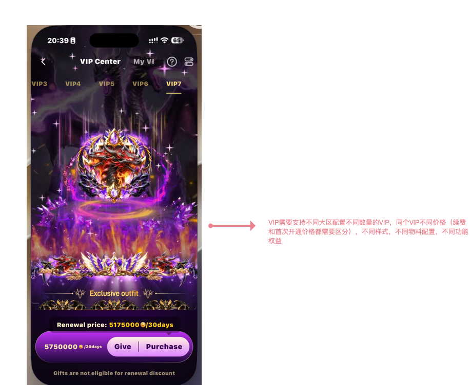

#### 功能点：本区 VIP 等级、价格与权益

##### 功能说明

不同大区可配置**不同数量的 VIP 等级**；相同 VIP 等级可按区配置不同的**首次开通价格、续费价格、样式、物料、功能权益**。VIP 页面按用户所属区展示该区等级，切换等级时同步展示该等级在本区的价格和权益；购买或续费按对应本区配置处理。

### 4.9 财富／魅力等级分区

#### 对应原型

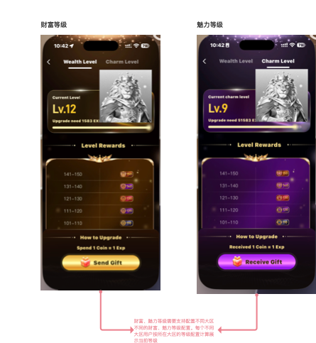

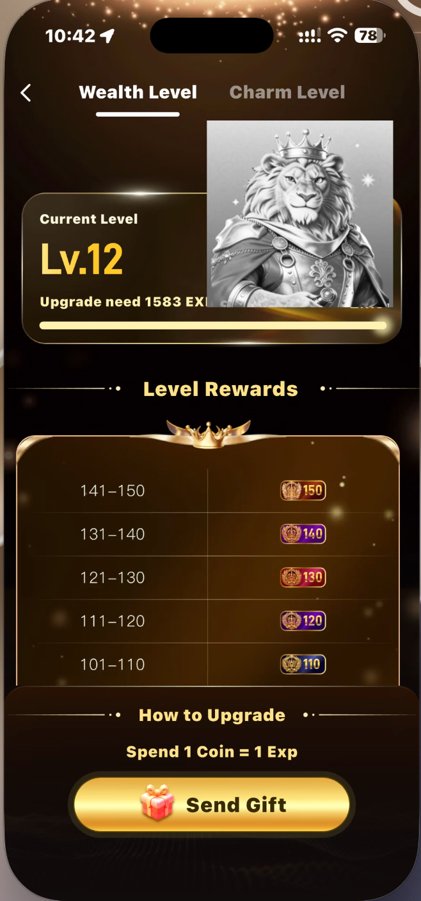

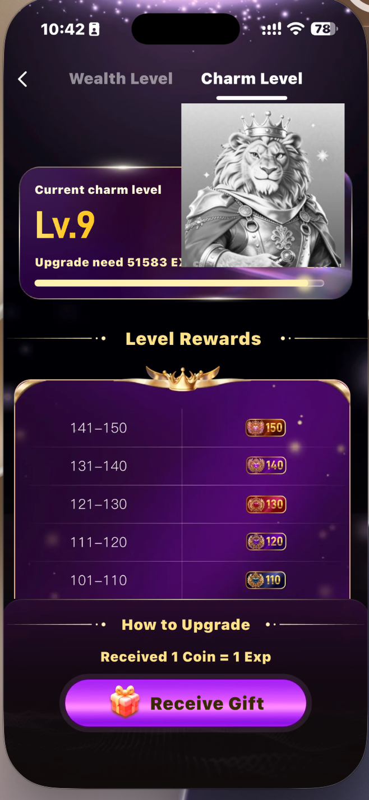

#### 功能点：本区财富与魅力等级

财富等级、魅力等级分别支持按大区配置等级规则。用户的财富等级和魅力等级分别依据**本人所属大区对应的等级配置**计算当前等级；财富、魅力两个 Tab 各自展示计算后的本区当前等级与升级进度。切换 Tab 时，展示对应类型的等级结果，不混用另一大区或另一类型的等级配置。

#### 功能点：送礼财富值与收礼魅力值分区

- 送礼用户获得的财富值，按**送礼用户所属大区**的财富值获取配置计算；收礼用户获得的魅力值，按**收礼用户所属大区**的魅力值获取配置计算。
- 获得的财富值、魅力值分别参与本人对应等级的计算；财富、魅力页的「How to Upgrade」说明分别按本人所属区的送礼、收礼获取配置展示。

## 5. 后台功能模块

### 5.1 VIP 发放

#### 对应原型

[VIP 发放完整画布](./原型图/1.0MVP_VIP发放_画布.png)

#### 功能点：VIP 赠送列表

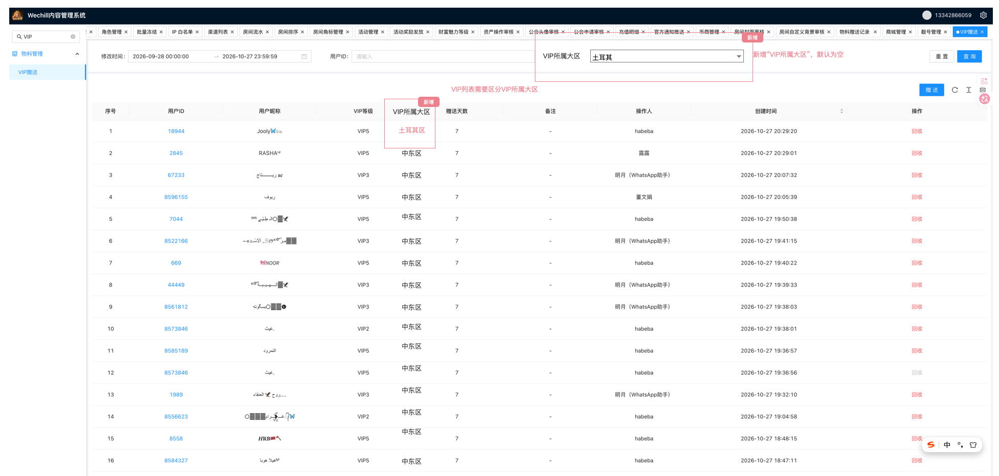

列表新增**VIP 所属大区**列和同名筛选项，筛选默认空；按所选大区查询、展示对应 VIP 赠送记录。

#### 功能点：申请赠送 VIP

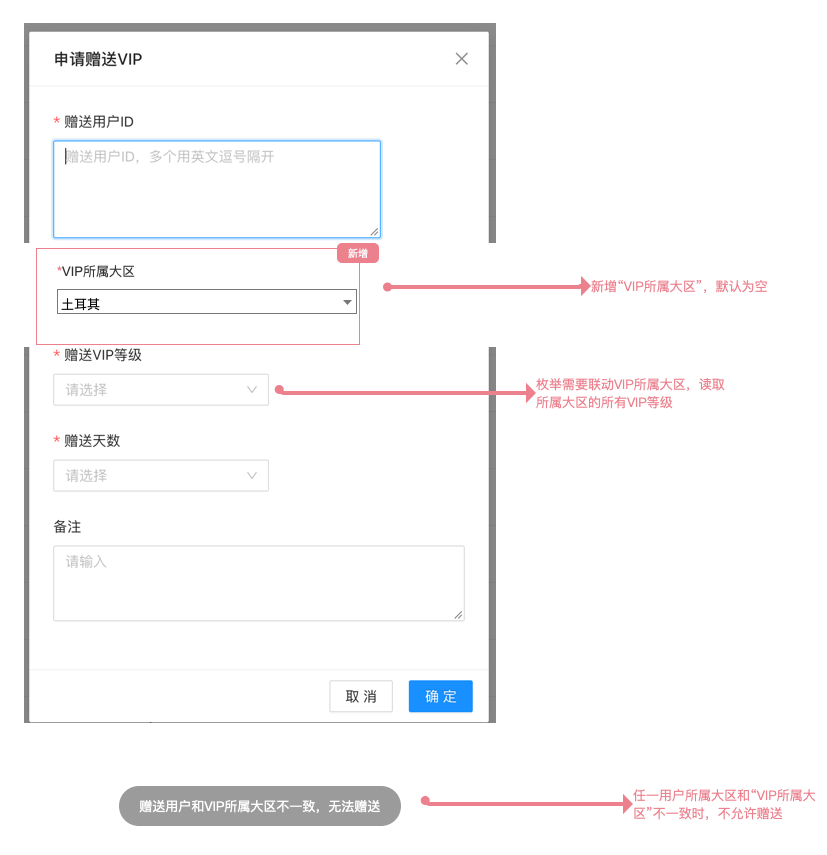

- 表单新增必填**VIP 所属大区**，默认空。
- 选定大区后，「赠送 VIP 等级」只列出**该大区的全部 VIP 等级**；重新选区时同步更新等级选项。
- 点击确定时，逐一校验所有赠送目标的所属大区；**任一目标与 VIP 所属大区不一致，则本次全部不赠送**，提示：`赠送用户和VIP所属大区不一致，无法赠送`。赠送执行使用提交时确定的目标用户 ID，不再通过号码重新定位。
